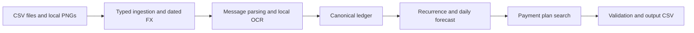

# Buy or Wait?

### Can you afford it without putting the next 90 days at risk?

An offline financial decision agent that checks future commitments before recommending a purchase. It combines transaction history, confirmed income, pending payments, messages, receipt images, and payment preferences to recommend **pay in full, pay partially, use installments, wait, or do not proceed**.

Built by [Yogesh Krishna](https://github.com/yogeshkrishna) for **HackerRank Orchestrate, September 2026**. The final competition prediction run was completed on **September 13, 2026**. This repository publishes the completed implementation after the event; its Git history records publication, not the original build timeline.

Python 3.12+ | Local neural OCR | Exact decimal arithmetic | No API key required

[Quick Start](#quick-start) / [How It Works](#how-it-works) / [Results](#results) / [Architecture](code/ARCHITECTURE.md) / [Final Predictions](output.csv)

## Why a Balance Check Is Not Enough

Two people with the same bank balance may have completely different spending capacity. Rent due tomorrow, a pending debit, a confirmed salary next week, and a preferred cash buffer can all change the answer.

Buy or Wait evaluates a payment plan against a daily forecast. A plan qualifies only when it completes by the requested deadline, respects the user's permitted payment methods, and keeps projected cash above their minimum balance throughout the forecast.

For example, a user has 1,000 available, wants to keep 200, and asks about a 700 purchase. Rent of 300 is due before the next confirmed salary of 800; an essential expense of 400 follows. The immediate safe amount is 500, rather than 800. If partial payment is allowed and accepted, the agent can evaluate paying 500 now and the remaining 200 after salary, then replay the entire schedule to verify it.

## How It Works



- **Reconstruct cash correctly.** Historical settled transactions inform recurrence without being applied again to the current balance. Pending credits and unrealized investments do not become spendable cash.
- **Use evidence with provenance.** English and Indonesian message templates and local OCR can clarify amounts, cancellations, salary amendments, and settlement dates. Evidence carries source identifiers; embedded commands cannot choose financial rules or tools.
- **Simulate before recommending.** The timeline includes request day through day 90: 91 calendar dates. Decimal arithmetic avoids binary floating-point errors in money calculations.
- **Respect the actual offers.** Installments must match supplied schedules, including fees. Partial payment follows the challenge's two-payment contract. Flexible recurring expenses may change only where the profile permits it.
- **Rank eligible plans deterministically.** Deadline compliance, no spending changes, lower total cost, earlier start, fewer payments, and payment-option ID determine the recommendation.
- **Explain and inspect.** Request-scoped evidence, ledger, forecast, and decision traces expose the reasoning with amounts redacted. A separate validator checks the serialized plan using the same forecast simulator.

The final prediction pipeline runs locally with deterministic rules and RapidOCR's neural models. An optional remote extraction adapter exists for explicitly enabled evidence diagnostics; it was not used in the final prediction run.

## Quick Start

Requires **Python 3.12 or newer**. Install the local OCR dependency once; subsequent extraction does not require a network connection.

```bash
git clone https://github.com/yogeshkrishna/buy-or-wait.git
cd buy-or-wait
python -m venv .venv
```

Activate the environment:

```bash
# macOS / Linux
source .venv/bin/activate
```

```powershell
# Windows PowerShell
.\.venv\Scripts\Activate.ps1
```

```bash
python -m pip install -r code/requirements-ocr.txt
python code/main.py --help
```

### Supply the Challenge Data

The competition corpus is not redistributed here. Obtain the participant-facing `dataset/` directory from the [organizer repository](https://github.com/interviewstreet/hackerrank-orchestrate-september26) and provide its absolute path. Keep all nine CSVs and the image directory together:

```text
dataset/
  requests.csv
  sample_requests.csv
  financial_profiles.csv
  financial_events.csv
  exchange_rates.csv
  request_payment_options.csv
  messages.csv
  images.csv
  output.csv
  media/images/<image_id>.png
```

Generation requires the full challenge schema, including the public sample file and blank output template. Public expected answers are available to the evaluation runner, but the production decision service does not use them to select predictions. This is a challenge-data application, rather than an arbitrary bank-statement importer.

### Generate and Inspect Decisions

Replace `/absolute/path/to/dataset` with the actual folder; Windows paths such as `C:\path\to\dataset` also work.

```bash
python code/main.py --dataset-dir /absolute/path/to/dataset --validate-inputs
python code/main.py --dataset-dir /absolute/path/to/dataset --generate-output --ocr rapidocr --output-csv predictions.csv
python code/main.py --dataset-dir /absolute/path/to/dataset --validate-output predictions.csv --ocr rapidocr
```

Writing `predictions.csv` preserves the original [competition output](output.csv). Generated output paths resolve relative to the repository root unless absolute. Input files remain read-only.

Inspect one request using an ID from the supplied file:

```bash
python code/main.py --dataset-dir /absolute/path/to/dataset --decision-trace request_26 --ocr rapidocr
```

Other inspection modes include `--evidence-trace`, `--ledger-trace`, `--forecast-trace`, and `--evidence-preflight`. Without OCR, structured input validation still works; unresolved mandatory image evidence is reported explicitly and never silently converted to zero.

## Output Contract

One row is produced for every evaluation request, in input order, with these exact columns:

| Field | Meaning |
| --- | --- |
| `request_id` | Source request identifier |
| `amount_safe_to_pay` | Maximum safe immediate payment before optional spending changes, capped at the request amount |
| `affordability_status` | `affordable_now`, `affordable_with_plan`, `affordable_later`, or `not_affordable` |
| `recommended_payment_method` | `full_payment`, `partial_payment`, `installments`, `wait`, or `not_recommended` |
| `payment_plan` | Chronological `YYYY-MM-DD:amount` entries separated by `\|`, or `none` |
| `earliest_date_for_full_payment` | First safe single-payment date within the forecast, independent of payment preferences |
| `spending_changes_needed` | Up to three permitted recurring-expense changes, or `none` |
| `decision_explanation` | Concise explanation grounded in the forecast and selected plan |

## Evaluation

Run the public-example scorecard:

```bash
python code/evaluation/decision_gate.py --dataset-dir /absolute/path/to/dataset --samples-only --ocr rapidocr --report evaluation-report.json
```

For full regeneration, serialized-plan replay, output hashing, and public-example comparison:

```bash
python code/evaluation/release_verify.py --dataset-dir /absolute/path/to/dataset --output reproduced.csv --report reproduction-report.json
```

The evaluator compares public answers after prediction. Runtime decision logic contains no request-specific answer table. The separate decision validator shares the forecast simulator, so a passing validation proves consistency with the implemented rules, rather than independent correctness of every financial assumption.

## Results

The September 13 final run generated **250 predictions**, with **zero unresolved mandatory-evidence requests** and **zero external model calls**. All 16 missing event amounts had an offline extraction path. The archived release check reproduced the output byte-for-byte and reported zero plan-validation errors.

| Public-example field | Exact matches |
| --- | ---: |
| Safe amount | 3 / 25 |
| Affordability status | 20 / 25 |
| Payment method | 21 / 25 |
| Payment plan | 20 / 25 |
| Earliest full-payment date | 20 / 25 |
| Spending changes | 21 / 25 |

Safe amounts were within 1% on 7 of 25 examples. These examples were reused for development calibration; the figures are **not held-out or hidden-test scores**. Zero contract errors does not imply 100% prediction accuracy. See the [final-run usage report](code/evaluation/usage_report.md) for model and cost accounting.

## Repository Map

```text
code/
  main.py                 CLI and composition root
  buywait/
    domain/               Money, typed models, enums, FX, serialization
    adapters/dataset/     Strict CSV parsing, joins, and lazy image access
    evidence/             Routing, extraction, conflict resolution, provenance
    providers/            Local OCR and optional remote evidence adapters
    ledger/               Lifecycle reconciliation and canonical cash flows
    forecasting/          Recurrence, timeline, policy, and simulation
    planning/             Candidate search, ranking, explanation, validation
    application/          Shared request-to-decision pipeline
    contracts/            Versioned interface metadata
  docs/contracts/schemas/ Machine-readable interface schemas
  evaluation/             Public scorecard, reproduction runner, usage report
output.csv                Original final competition predictions
```

## Tradeoffs and Limits

The main accuracy gap is exact safe-amount estimation: recurrence inference, variable spending estimates, and event timing can change the tightest forecast balance. The frozen policy processes supported same-day credits before payments while preserving opening-balance floor checks, and estimates protected variable expenses using the lower median of up to eight recent observations.

OCR can misread amounts, message parsing covers supported templates rather than unrestricted language understanding, and matching recurring flows to explicit future events uses coarse date/category identities. Spending-change search is bounded to three events and supported reduction amounts. The current installment limit treats payment count as a month proxy, which needs improvement for nonmonthly offers. Free-text priorities are stored but are not fully interpreted by the planner; structured preferences and protected categories drive personalization.

This is the completed hackathon CLI implementation. Its safety claims apply to the supplied evidence and fixed forecast assumptions, not guaranteed real-world outcomes. There is no hosted interface or live banking connection.
